# Benutzerhandbuch AmbiBack Manager

[Zurück zur Projektübersicht](../README.de.md)

Mit dem AmbiBack Manager finden, einrichten und steuern Sie AmbiBack-Controller von Ihrem Android-Gerät aus. Dieses Handbuch gilt für Version 1.4.

Die aktuelle Version laden Sie auf der [Release-Seite](https://github.com/ambiback/ambiback-manager/releases/latest) herunter: Öffnen Sie dort die `.apk`-Datei auf Ihrem Telefon oder scannen Sie den QR-Code. Android fragt beim ersten Mal, ob Sie Apps aus dieser Quelle installieren dürfen.

> Die Bilder stammen aus einem Android-Emulator mit einem simulierten Controller („Living Room TV“ unter 127.0.0.1). Auf Ihrem Gerät sehen Name, IP-Adresse und Messwerte anders aus.

## Inhalt

1. [Geräte finden](#geräte-finden)
2. [Gerät per IP hinzufügen](#gerät-per-ip-hinzufügen)
3. [Neues Gerät einrichten](#neues-gerät-einrichten)
4. [Gerät steuern](#gerät-steuern)
5. [Erweitert und Weboberfläche](#erweitert-und-weboberfläche)
6. [Menü und Geräteverwaltung](#menü-und-geräteverwaltung)
7. [Gerät über USB verwalten](#gerät-über-usb-verwalten)
8. [Einstellungen](#einstellungen)
9. [Wenn etwas nicht klappt](#wenn-etwas-nicht-klappt)

## Geräte finden

Beim Öffnen sucht die App automatisch im WLAN nach AmbiBack-Controllern. Telefon und Controller müssen dazu im selben Netzwerk sein. Eine neue Suche starten Sie auf drei Wegen:

- mit dem Kreispfeil oben rechts,
- indem Sie die Liste nach unten ziehen,
- bei leerer Liste mit **Nach Geräten suchen**.

Findet die App nichts, bietet sie zusätzlich **Per IP hinzufügen** an.

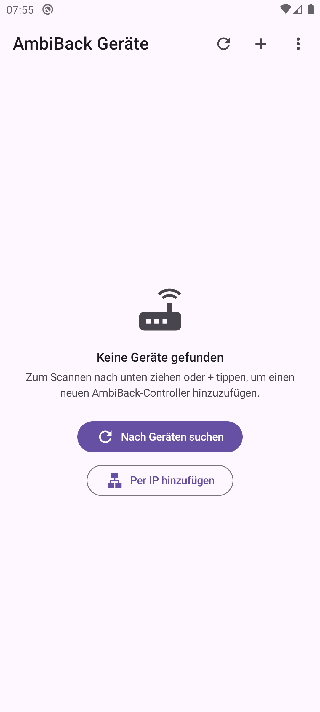

Jede Karte zeigt Name, IP-Adresse, den aktuellen Modus (zum Beispiel „Ambient“) und die Firmware-Version. Tippen Sie auf eine Karte, um das Gerät zu steuern.

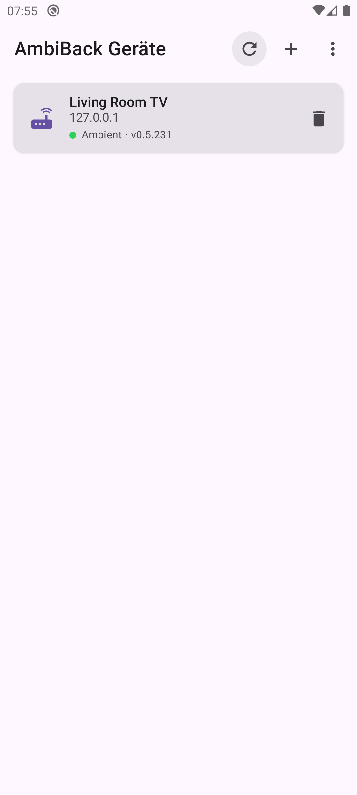

Gespeicherte Geräte erscheinen sofort, auch bevor die Suche sie bestätigt hat:

- **Unbestätigt**: Das Gerät ist gespeichert, die Suche läuft noch oder wurde nicht gestartet.
- **Nicht gefunden**: Die letzte Suche hat das Gerät nicht gefunden. Es ist vermutlich aus, in einem anderen Netz, oder es antwortet nicht auf die Suche. Sie können es trotzdem öffnen.

## Gerät per IP hinzufügen

Kennen Sie die IP-Adresse des Controllers (zum Beispiel aus Ihrem Router), wählen Sie im Menü ⋮ **Per IP hinzufügen**. Die App fragt das Gerät ab, bevor sie es speichert. Ist die Adresse ungültig oder antwortet dort kein Controller, steht der Grund direkt unter dem Eingabefeld.

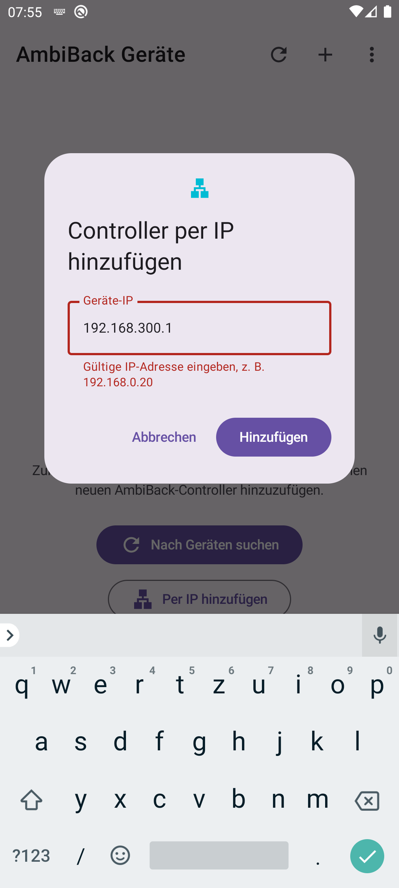

## Neues Gerät einrichten

Ein neuer oder zurückgesetzter Controller hat noch kein WLAN. Er öffnet dann einen eigenen Access Point. Bei einem bereits eingerichteten Controller öffnen Sie den Access Point am Gerät: die Taste 4 bis 7 Sekunden halten oder den Strom dreimal im Abstand weniger Sekunden einschalten.

1. Tippen Sie in der Geräteliste auf **+**.
2. Tippen Sie auf **Nach neuen Geräten suchen**. Die App fragt dafür nach Standort- und WLAN-Berechtigung, weil Android sonst keine WLAN-Namen herausgibt. Ab Android 10 verbindet sich die App dann selbst. Sie bestätigen nur das AmbiBack-Netzwerk im Android-Dialog. Alternativ verbinden Sie das Telefon selbst mit dem WLAN des Controllers und tippen auf **Ich habe mich selbst mit dem Geräte-WLAN verbunden**.
3. Findet die App mehrere Controller, wählen Sie einen aus.
4. Wählen Sie, wie der Controller in Ihr WLAN kommt:
   - **WPS starten**: Danach drücken Sie die WPS-Taste an Ihrem Router.
   - **WLAN-Daten eingeben**: Sie geben WLAN-Name und Passwort ein, tippen auf **Senden** und danach auf **Fertigstellen**.
5. Der Controller startet neu. Verbinden Sie das Telefon wieder mit Ihrem gewohnten WLAN und suchen Sie nach Geräten.

Klappt die Verbindung nicht, etwa wegen eines falschen Passworts, ändern Sie mit **WLAN-Daten ändern** die Eingaben und versuchen es erneut.

Unten zeigt die App, wie lange das Einrichtungsfenster noch offen ist. Läuft es ab, starten Sie die Einrichtung neu.

Beim Einrichten koppelt sich die App mit dem Controller und speichert einen **Geräteschlüssel**. Den brauchen Sie später für Neustart, WPS und Firmware-Updates im Browser.

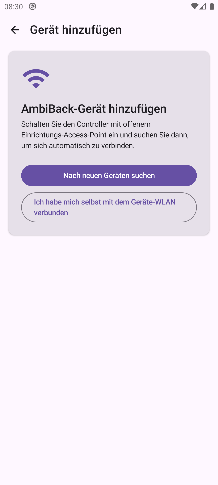

## Gerät steuern

Die Gerätesteuerung hat drei Reiter: **Steuerung**, **Erweitert** und **Weboberfläche**. Oben stehen Name und IP-Adresse des Geräts. Der Kreispfeil lädt den aktuellen Reiter neu, das Pfeil-Symbol daneben öffnet das Gerät in Ihrem Browser.

### Steuerung

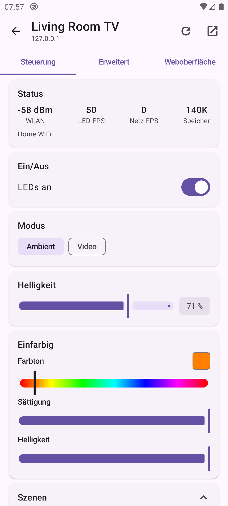

- **Status**: WLAN-Signal in dBm, LED-Bildrate, Bildrate der Netzwerkdaten, freier Speicher und der Name des WLANs. Die Werte aktualisieren sich alle 5 Sekunden, solange dieser Reiter offen ist. Zum sofortigen Aktualisieren ziehen Sie die Seite nach unten.
- **Ein/Aus**: schaltet die LEDs ein und aus. Eingeschaltet wird im darunter gewählten Modus.
- **Modus**: **Ambient** für Farben und Szenen aus der App, **Video** für Bilddaten aus dem Netzwerk, zum Beispiel vom PC. Controller mit Kamera zeigen hier nur den Kameramodus.
- **Helligkeit**: Gesamthelligkeit in Prozent.
- **Einfarbig**: Farbton, Sättigung und Helligkeit wählen. Die Farbe wird beim Loslassen gesendet, und das Gerät wechselt dabei automatisch auf Ambient mit der Szene „Einfarbig“.

### Szenen

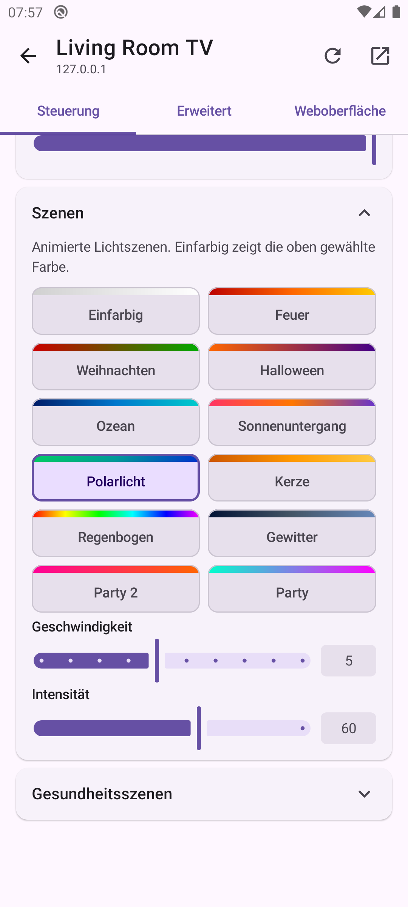

Tippen Sie auf eine Szene, um sie zu starten. Die gewählte Szene ist umrandet. **Geschwindigkeit** (1–10) und **Intensität** (1–100) gelten für die animierten Szenen.

### Gesundheitsszenen

Die Gesundheitsszenen sind eingeklappt. Tippen Sie auf die Überschrift, um sie zu öffnen.

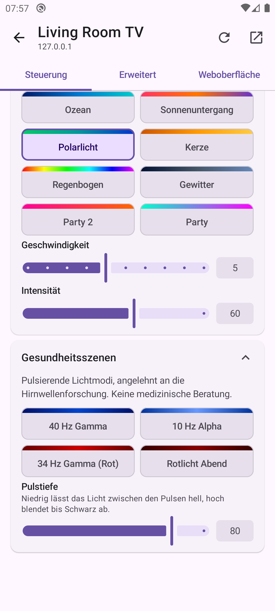

- **40 Hz Gamma**, **10 Hz Alpha** und **34 Hz Gamma (Rot)** lassen die LEDs schnell flackern.
- **Rotlicht Abend** pulsiert langsam rot. Die Geschwindigkeit stellen Sie mit dem Szenen-Regler ein.
- **Pulstiefe**: Niedrig lässt das Licht zwischen den Pulsen hell, hoch blendet bis Schwarz ab.

Vor der ersten Flacker-Szene fragt die App nach, denn schnelles Flackern kann bei Menschen mit fotosensitiver Epilepsie Anfälle auslösen. Die Gesundheitsszenen sind angelehnt an Forschung zu Hirnwellen und **keine medizinische Behandlung**.

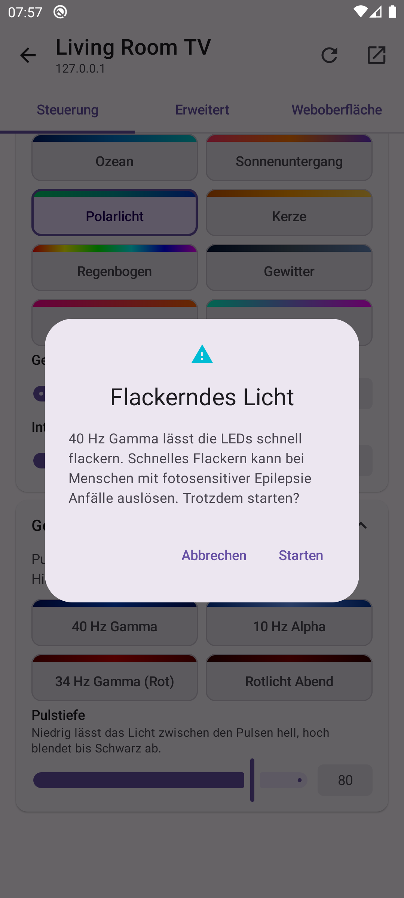

Wurde das Gerät mit dieser App eingerichtet, steht unten zusätzlich der **Geräteschlüssel**. Mit **Anzeigen** sehen Sie ihn, mit **Kopieren** legen Sie ihn in die Zwischenablage.

## Erweitert und Weboberfläche

- **Erweitert** zeigt die vollständige AmbiBack-Oberfläche mit allen Einstellungen des Controllers. Die App gibt ihr den Geräteschlüssel automatisch mit.
- **Weboberfläche** zeigt die Seite, die der Controller selbst ausliefert.

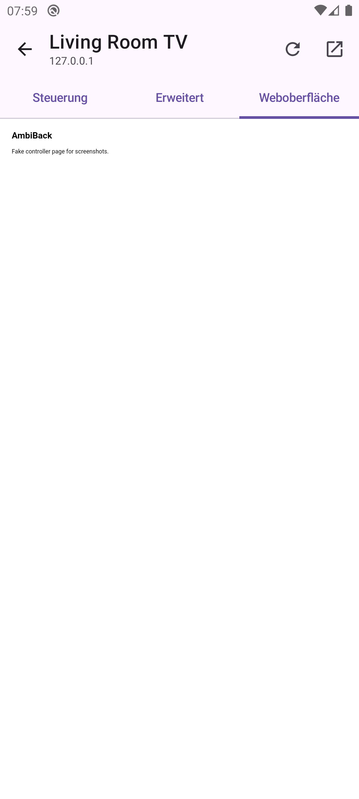

Die Zurück-Taste Ihres Telefons blättert innerhalb dieser Seiten zurück. Erst auf der ersten Seite verlassen Sie das Gerät. Lädt eine Seite nicht, zeigt die App einen Hinweis mit **Erneut versuchen**.

## Menü und Geräteverwaltung

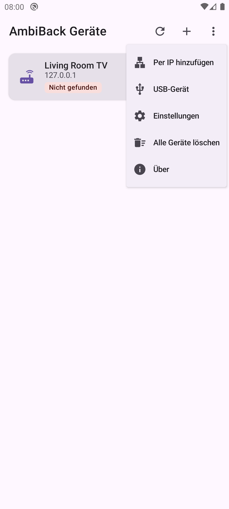

- **Gerät vergessen**: Papierkorb auf der Karte. Mit **Rückgängig** in der Meldung unten holen Sie es zurück.
- **Alle Geräte löschen**: entfernt alle gespeicherten Geräte von diesem Telefon. Die Controller selbst bleiben unverändert und lassen sich wieder finden.
- **Über**: Version der App und Link zu ambiback.de.

## Gerät über USB verwalten

Schließen Sie den Controller per USB-Kabel an das Telefon an. Die App öffnet den USB-Bildschirm dann von selbst. Sie erreichen ihn auch über das Menü unter **USB-Gerät**.

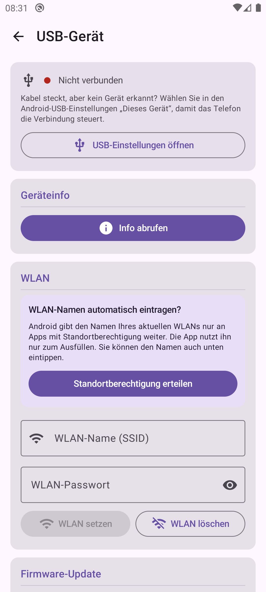
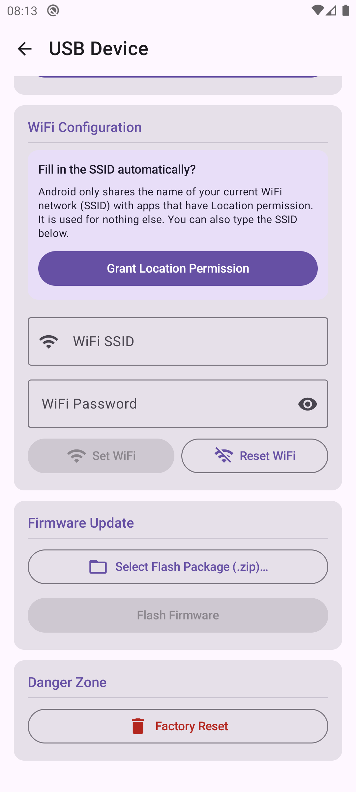

- Erkennt das Telefon das Kabel nicht, öffnen Sie mit **USB-Einstellungen öffnen** die Android-Einstellungen und wählen dort „Dieses Gerät“, damit das Telefon die Verbindung steuert.
- **Info abrufen** liest Typ, Version, ID, MAC-Adresse, Name und IP-Adresse aus.
- **WLAN**: WLAN-Name und Passwort eintragen und mit **WLAN setzen** senden. **WLAN löschen** entfernt die gespeicherten WLAN-Daten, danach startet das Gerät neu. Mit Standortberechtigung trägt die App den Namen Ihres aktuellen WLANs selbst ein. Ohne Berechtigung tippen Sie ihn ein.
- **Firmware-Update**: Mit **Flash-Paket (.zip) wählen** die Datei aussuchen und mit **Firmware aufspielen** übertragen. Ein Balken zeigt den Fortschritt. Ziehen Sie das Kabel dabei nicht ab und bleiben Sie auf dem Bildschirm. Der Bildschirm bleibt währenddessen an.
- **Werkseinstellungen** im Gefahrenbereich löscht alle Einstellungen des Controllers. Das lässt sich nicht rückgängig machen.

## Einstellungen

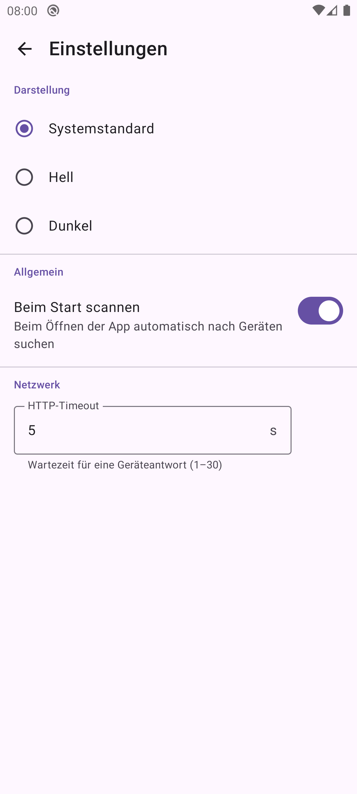

- **Darstellung**: Systemstandard, Hell oder Dunkel. Ab Android 12 gibt es zusätzlich **Systemfarben verwenden**. Dann übernimmt die App die Farben Ihres Hintergrundbilds.
- **Beim Start scannen**: Suche beim Öffnen der App ein- oder ausschalten.
- **HTTP-Timeout**: wie viele Sekunden (1–30) die App auf eine Antwort des Controllers wartet. Bei langsamem WLAN hilft ein höherer Wert.

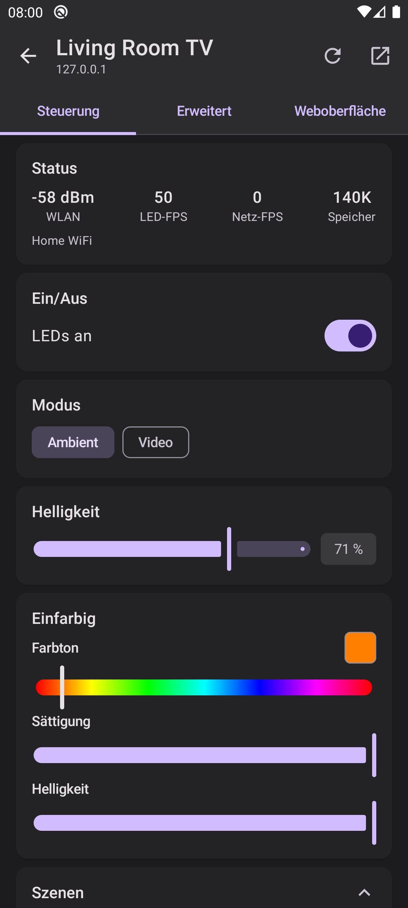

## Wenn etwas nicht klappt

**Die Suche findet keine Geräte.**
Prüfen Sie, ob Telefon und Controller im selben WLAN sind. Ein aktives VPN oder ein Gäste-WLAN kann die Suche blockieren. Sie können das Gerät dann direkt [per IP hinzufügen](#gerät-per-ip-hinzufügen).

**Ein Gerät zeigt „Nicht gefunden“.**
Öffnen Sie es trotzdem. Lädt die Steuerung, hat nur die Suche das Gerät verpasst. Lädt sie nicht, ist der Controller aus oder hat eine neue IP-Adresse bekommen. Dann suchen Sie neu oder fügen ihn mit der neuen Adresse hinzu.

**Die Steuerung meldet, dass die Einstellungen nicht geladen werden konnten.**
Tippen Sie auf **Erneut versuchen**. Hilft das nicht, erhöhen Sie in den Einstellungen das HTTP-Timeout.

**Der Reiter „Erweitert“ bleibt leer oder schwarz.**
Der Reiter läuft auch mit älteren Versionen von „Android System WebView“, wie sie auf Android 8 bis 10 oft noch installiert sind. Bleibt er trotzdem leer, aktualisieren Sie „Android System WebView“ im Play Store. Bis dahin funktioniert der Reiter **Weboberfläche**.
